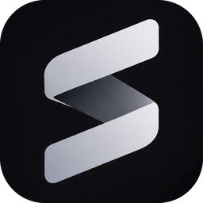
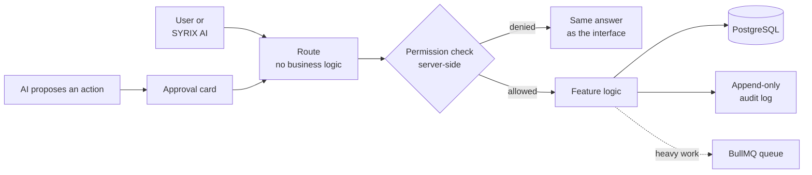

<p align="center">
  
</p>

<h1 align="center">SYRIX Forma</h1>

<p align="center">
  <b>An internal operating platform for a team — tasks, clients, projects, calendar, email, chat, documents, HR and reporting in one web app, with permissions enforced on the server and an AI assistant that asks before it acts.</b>
</p>

<p align="center">
  TypeScript · Next.js · React · PostgreSQL · Drizzle · BullMQ · Clerk<br>
  <a href="https://kabirr-kohli.pages.dev/work">Project page</a> ·
  <a href="https://kabirr-kohli.pages.dev">Portfolio</a>
</p>

<br>

## Why it exists

A small team usually runs on spreadsheets, inbox threads and memory: who owes a client a reply, which task is overdue, who is on leave, where the signed document went. SYRIX Forma brings that into one place and removes the remembering, chasing and copying — but only where that is safe. Its first rule is **automation is rule-driven, AI suggests, and humans and explicit rules decide.** It is the largest web application I have built: 590 TypeScript files, 78 database tables and 81 test files.

## Highlights

| | |
|---|---|
| **Work** | My Work, tasks with recurrence and timelines, clients, projects and project templates, and a unified action centre on the home screen |
| **Communication** | Calendar, email, and team chat with file and document attachments |
| **HR** | Employee records, leave, absence, expenses and payroll exports, with personal data encrypted at rest |
| **Automations** | Rule-driven follow-ups and reminders on a background queue, behind an admin kill-switch |
| **Reports and search** | Permission-scoped reporting and global search across everything a user is allowed to see |
| **SYRIX AI** | Answers from the platform's own data and from live research — company filings, market data, news and the web — with every source cited. Anything that would change data appears as an approval card first |

## How a request is handled



## Security

| | |
|---|---|
| **Permissions** | Six roles and two capability flags, checked **server-side on every action** — a hand-crafted request gets exactly the answer the interface would. See [`docs/permissions-matrix.md`](docs/permissions-matrix.md) |
| **Sign-in** | Clerk sessions, TOTP multi-factor authentication, and step-up re-authentication for sensitive changes |
| **Encryption** | HR personal data, integration credentials and MFA secrets encrypted with AES-256-GCM, each under its own derived key, so a value encrypted for one purpose cannot be decrypted as another |
| **Audit** | Append-only log of who, when, what and result — never passwords, tokens or AI prompt content |
| **AI safety** | Emails, pages and documents are untrusted input; nothing in them can trigger an action without a person approving it, and the server re-checks permissions when the approved action runs |
| **CI** | Typecheck, lint, tests against a throwaway Postgres container, `npm audit`, OSV-Scanner, gitleaks secret scanning and Semgrep static analysis |

The rules the code is written to are in [`docs/engineering-rules.md`](docs/engineering-rules.md); the threat model is in [`docs/threat-model.md`](docs/threat-model.md).

## Engineering notes

- **Hiding a button is not a control.** Every permission decision lives in `lib/permissions/` and runs on the server, and every feature has an authorisation test that actually tries the wrong-permission path.
- **Capabilities beside roles.** A person holds exactly one role, but some people legitimately need two kinds of access — a bookkeeper who is otherwise a plain employee, or an admin who also runs HR and would otherwise lose the screen that grants roles. Two capability flags (`financeAccess`, `hrAdmin`) cover that without widening anyone's business-data scope, and a security admin can never hold either.
- **A dead integration degrades a feature, never the app.** Calendar, mail and document systems stay authoritative for their own data; the platform keeps references and sync state, and a broken link is never a lost record.
- **The assistant cannot act on what it reads.** Content from emails and web pages is marked as data. An approval card is shown for any change, and approving it runs the full authorisation check again at execution time rather than trusting the moment it was proposed.
- **Free tiers, verified.** Every dependency's free-tier ceiling is recorded in `DEPENDENCIES.md`, after checking each service's actual terms rather than assuming them.

## Repository layout

```
apps/web/
  app/          routes only — no business logic
  features/     one folder per feature: tasks, clients, projects, hr, chat, forma-ai …
  lib/          auth, db, permissions, integrations, ai
  tests/        unit, integration and authorisation tests (Vitest)
docs/           engineering rules, data model, permissions matrix, data classification, threat model
```

## Running it

Requires Node.js 22, PostgreSQL and Redis.

```
cd apps/web
cp ../../.env.example .env.local     # fill in the values
npm install
npm run db:migrate
npm run dev
```

```
npm run typecheck && npm run lint && npm test
```

## Development history

Developed in a private repository — 177 commits, September to October 2026 — and published here as a curated snapshot. The working history stays private because it contains local configuration from development.

---

<p align="center"><sub>© 2026 Kabirr Kohli. All rights reserved. Published for viewing; no licence is granted to copy, modify or redistribute. The starter shell's MIT licence is kept in <code>THIRD_PARTY_NOTICES/</code>.</sub></p>
